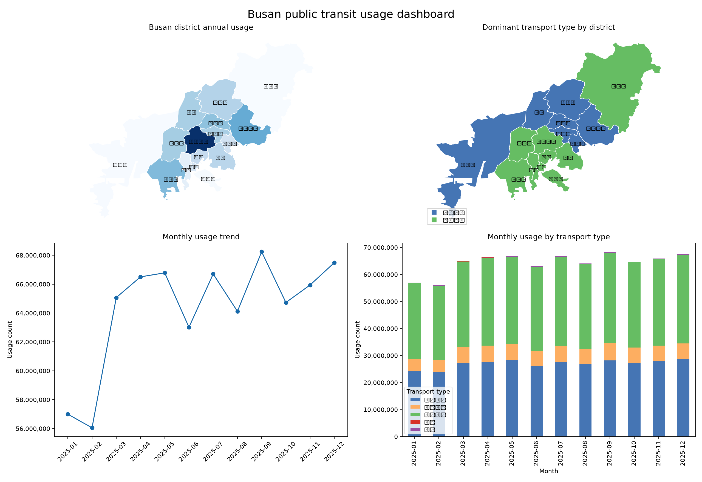

# 대중교통 이용 데이터 수집·분석 파이프라인

국토교통부 [시군구별 교통수단별 이용량](https://www.data.go.kr/data/15162136/fileData.do) CSV를 대상으로 전국 비교와 부산 구·군 심층 분석을 수행하는 Python/SQL 프로젝트입니다.

## 시작하기

1. 공공데이터포털에서 CSV를 내려받아 `data/raw/`에 저장합니다.
2. 파일명을 `transport_usage.csv`로 맞춥니다.
3. Python 3.11 이상 환경에서 의존성을 설치합니다.

```powershell
python -m venv .venv
.\.venv\Scripts\Activate.ps1
pip install -r requirements.txt
```

PostgreSQL까지 사용하려면 `.env.example`을 `.env`로 복사한 뒤 비밀번호를 설정하고
Docker Compose로 데이터베이스와 파이프라인을 함께 실행할 수 있습니다.

```powershell
Copy-Item .env.example .env
# .env의 POSTGRES_PASSWORD를 로컬 비밀번호로 변경
docker compose up --build
```

PostgreSQL 연결 주소는 `POSTGRES_DSN` 환경 변수로 변경할 수 있습니다.
`src.load_postgres`는 정제된 CSV 3종을 PostgreSQL의
`transport_usage`, `transport_person`, `transport_hourly` 테이블로 적재하고
각 테이블의 행 수를 검증합니다. `docker compose up --build`는 파이프라인과
PostgreSQL을 함께 실행하며, 적재 결과를 컨테이너 로그에 출력합니다. Docker가 설치되지 않은 환경에서도 기본
SQLite 파이프라인은 그대로 실행할 수 있습니다.

Docker 없이 이미 PostgreSQL 서버를 실행 중이라면 PowerShell에서 연결 주소를
설정한 뒤 적재할 수 있습니다.

```powershell
$env:POSTGRES_DSN = "postgresql://transit:<password>@localhost:5432/transit"
python -m src.load_postgres
```

### Docker + PostgreSQL 검증 결과

Docker Desktop의 WSL 2 엔진에서 `postgres:16`과 pipeline 컨테이너를 실행해
실제 연결·적재를 검증했습니다.

```text
transport_usage: 315,505행
transport_person: 96,366행
transport_hourly: 1,843,188행
pipeline exit code: 0
```

검증 명령은 다음과 같습니다.

```bash
export POSTGRES_PASSWORD="local-password"
docker compose up --build --abort-on-container-exit --exit-code-from pipeline
```

Windows PowerShell에서는 WSL 터미널에서 위 명령을 실행하거나,
`wsl -d Ubuntu -- bash -lc "..."` 형식으로 실행합니다.

4. 데이터 이해 및 품질 검증을 실행합니다. 기존 교통수단별 CSV와 추가된
이용인원·시간대별 CSV를 함께 검사합니다.

```powershell
python -m src.inspect_data
```

정제 파일과 SQLite 데이터베이스를 생성하려면:

```powershell
python -m src.clean_data
python -m src.load_sqlite
python -m src.analyze
```

전체 단계를 한 번에 실행하고 로그를 남기려면:

```powershell
python -m src.run_pipeline
```

실행 로그는 `logs/pipeline.log`에 저장됩니다.
단계 실패 시 각 단계는 1회 자동 재시도하며, Windows 작업 스케줄러에는
`scripts/run_scheduled.ps1`을 등록해 정기 실행할 수 있습니다.
작업 스케줄러의 프로그램에는 `powershell.exe`, 인수에는
`-ExecutionPolicy Bypass -File "...\scripts\run_scheduled.ps1"`를 지정합니다.

## 단계별 완료 기준

- 1단계: `src.inspect_data`가 원천 CSV의 컬럼, 기간, 행 수, 결측치, 중복을 출력한다.
- 2단계: `src.clean_data`가 표준 컬럼과 자료형을 갖춘 `data/processed/transport_usage_clean.csv`를 생성한다.
- 3단계: `src.load_sqlite`가 `data/processed/transport_usage.sqlite`를 생성하고 SQL 집계를 실행한다.
- 4단계: `src.analyze`가 전국 및 부산 Python 집계와 SQL 집계의 일치를 검증하고 그래프를 생성한다.

## 프로젝트 완료 체크리스트

- [x] 전국 원본 데이터 수집 및 출처·기간·단위 기록
- [x] 결측값·중복·자료형·지역명·교통수단명 점검 및 정제
- [x] 정제 CSV를 SQLite에 저장하고 CSV·DB 건수 검증
- [x] 전국 지역·교통수단·기간·시군구 분석 SQL 5개 이상 작성
- [x] 부산 구·군별 심층 분석 및 결과 해석
- [x] 수집된 원본 확인부터 DB 저장·분석까지 단일 파이프라인 실행
- [x] 분석 그래프와 재현 가능한 README 작성
- [x] 데이터 품질 자동 테스트와 실패 단계 재시도
- [x] PostgreSQL 적재 모듈과 Docker Compose 실행 환경
- [x] GitHub Repository 공개: [FB1937/transport-data-pipeline](https://github.com/FB1937/transport-data-pipeline)

SQL 분석 쿼리는 `sql/analysis.sql`에 6개가 있으며, Python·SQL 결과 일치도
`python -m src.analyze`에서 검증합니다.

분석 결과는 `reports/analysis_summary.csv`에 저장되며, 그래프는 다음 위치에 생성됩니다.

- `reports/figures/usage_by_sido.png`: 전국 시도별 이용량
- `reports/figures/busan_usage_by_sigungu.png`: 부산 구·군별 이용량
- `reports/figures/busan_usage_by_transport.png`: 부산 구·군별 교통수단 구성
- `reports/figures/usage_by_month.png`: 월별 이용량
- `reports/analysis_report.md`: 주요 결과, 해석 및 재현 방법
- `reports/monthly_summary.csv`: 월별 집계 결과
- `reports/person_summary.csv`: 시도별 총 이용인원 집계
- `reports/busan_hourly_summary.csv`: 부산 시간대별 이용량
- `reports/figures/busan_usage_by_hour.png`: 부산 시간대별 이용량 그래프
- `reports/busan_monthly_summary.csv`: 부산 월별 이용량·전월 대비 증감률·분기
- `reports/busan_transport_share.csv`: 부산 교통수단별 이용량 및 점유율
- `reports/busan_time_period_summary.csv`: 부산 심야·출근·주간·퇴근·저녁 구간별 이용량
- `reports/busan_seasonal_summary.csv`: 부산 계절별 이용량 요약
- `reports/busan_hypothesis_test.csv`: 퇴근·심야 시간대 Welch t-test 결과
- `reports/busan_district_profile.csv`: 구·군별 이용량·이용인원·이용량/이용인원 비교
- `reports/figures/busan_hourly_heatmap.png`: 부산 구·군별 시간대 히트맵
- `reports/dashboard.png`: 부산 구·군 지도와 기간·교통수단 종합 대시보드
- `reports/dashboard.html`: 브라우저용 대시보드
 
대시보드의 지도는 부산 구·군 경계 GeoJSON을 이용합니다. HTML 대시보드에서는
구·군별 시간대 히트맵과 구·군·교통수단 필터를 제공하며, 선택한 조건의 시간대별
이용량과 교통수단별 구성을 확인할 수 있습니다.

부산 집중 분석에서는 구·군별 교통수단 점유율, 월별 전월 대비 증감률과
분기별 흐름을 함께 산출합니다. 추가로 시간대 구간 비교, 계절성 요약,
퇴근·심야 Welch t-test, 구·군별 이용량·이용인원 수요 프로필을 산출합니다.

### 대시보드 미리보기



브라우저에서 대시보드를 열려면
[dashboard.html](reports/dashboard.html)을 내려받아 실행합니다.

데이터 출처와 실제 파일의 관측 단위·인코딩·품질 결과는
`docs/data_spec.md`에 기록되어 있습니다.

## 데이터 계약

원천 파일에는 다음 컬럼이 있어야 합니다.

`운행일자`, `시도코드(법정동)`, `시도명`, `시군구코드(법정동)`, `시군구명`, `교통수단명`, `이용량`

데이터 제공 범위와 컬럼 정의는 원천 페이지를 기준으로 확인하며, 실제 CSV의 인코딩은 자동으로 UTF-8/CP949 순서로 탐색합니다.
