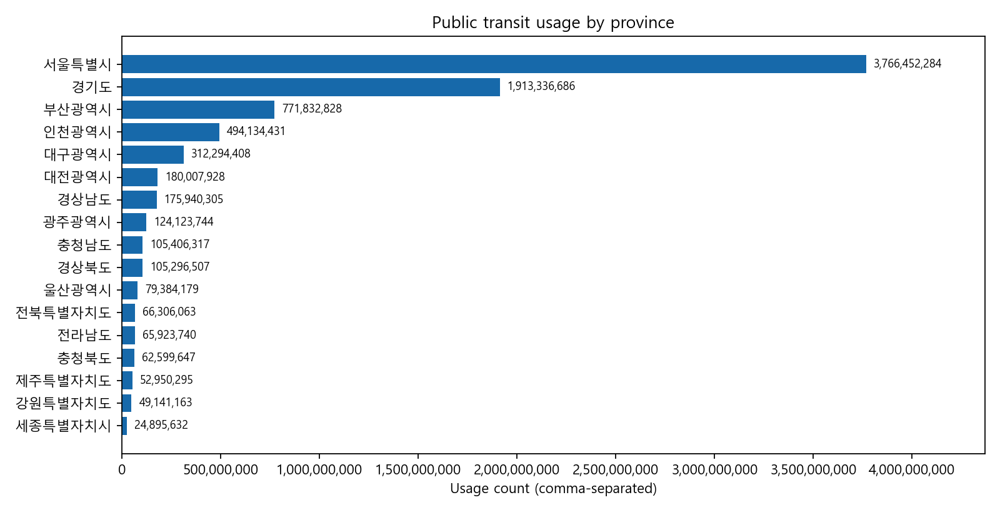
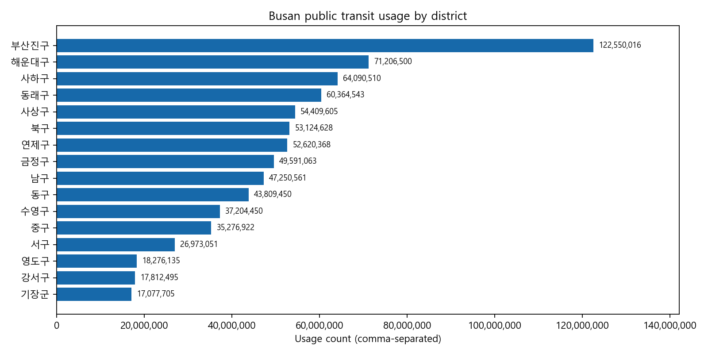
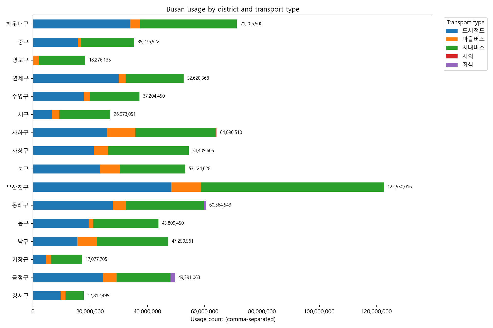
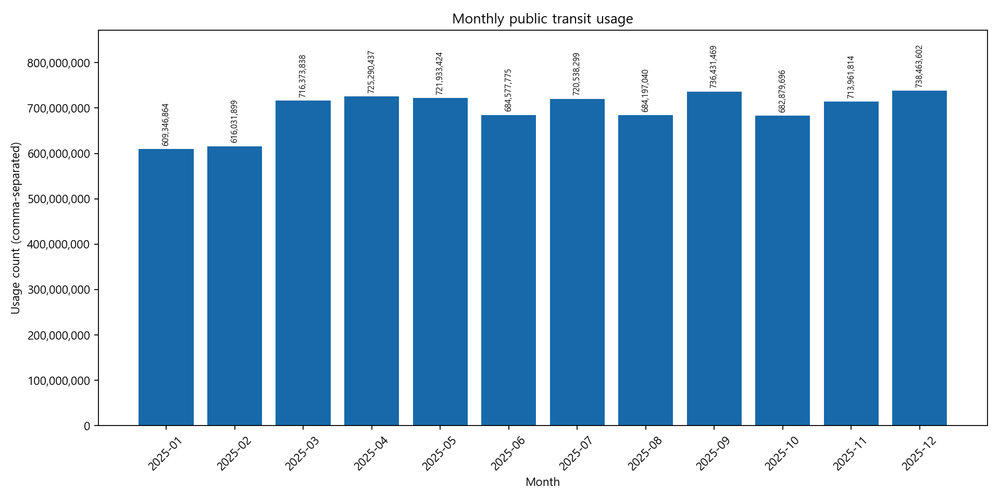

# 대중교통 이용량 분석 리포트

## 1. 분석 개요

- 분석 기간: 2025-01-01 ~ 2025-12-31
- 분석 행 수: 315,505행
- 분석 지역: 17개 시·도
- 원천 데이터 결측치: 0건
- 완전 중복 행: 0건
- 분석 기준: `이용량` 합계
- 추가 분석 기준: `이용인원` 및 `시간대별 이용량`

분석 결과는 정제 CSV와 SQLite 데이터베이스를 기준으로 산출했으며,
Python 집계와 SQL 집계가 일치하는지 자동 검증했습니다.

## 2. 전국 시·도별 결과

이용량 상위 지역은 다음과 같습니다.

| 순위 | 지역 | 총 이용량 |
|---:|---|---:|
| 1 | 서울특별시 | 3,766,452,284 |
| 2 | 경기도 | 1,913,336,686 |
| 3 | 부산광역시 | 771,832,828 |
| 4 | 인천광역시 | 494,134,431 |
| 5 | 대구광역시 | 312,294,408 |



## 3. 부산 구·군별 결과

부산에서는 다음 구·군의 이용량이 높게 나타났습니다.

| 순위 | 구·군 | 총 이용량 |
|---:|---|---:|
| 1 | 부산진구 | 122,550,016 |
| 2 | 해운대구 | 71,206,500 |
| 3 | 사하구 | 64,090,510 |
| 4 | 동래구 | 60,364,543 |
| 5 | 사상구 | 54,409,605 |



## 4. 부산 교통수단별 결과

부산 16개 구·군 합계에서는 `시내`와 `도시철도`의 이용량이 가장 큰 비중을 차지했습니다.

| 순위 | 교통수단 | 총 이용량 |
|---:|---|---:|
| 1 | 시내 | 377,490,349 |
| 2 | 도시철도 | 324,070,696 |
| 3 | 마을 | 67,340,609 |
| 4 | 좌석 | 2,408,088 |
| 5 | 시외 | 328,260 |



## 5. 월별 변화

부산 16개 구·군만 대상으로 월별 집계와 전월 대비 증감률을 산출했습니다.
상세 결과는 `busan_monthly_summary.csv`에 저장합니다. 전국 월별 결과는
`monthly_summary.csv`에 별도로 저장합니다.



## 6. 부산 추가 지표

부산 교통수단별 점유율은 `busan_transport_share.csv`에서 확인할 수 있습니다.
점유율은 부산 구·군의 총 이용량 대비 각 교통수단 이용량의 비율입니다.
월별 증감률은 전월 대비 변화율이며, 1월은 비교할 전월이 없어 0으로 표시합니다.

시간대별 분석에서는 17시 이용량이 가장 높았고(55,826,810건), 03시가 가장
낮았습니다(83건). 시간대별 상세 결과는 `busan_hourly_summary.csv`에 저장하고,
그래프는 `figures/busan_usage_by_hour.png`에서 확인할 수 있습니다.

## 7. 해석 시 유의사항

- 이용량은 승객 수 또는 이용 건수 집계이며, 인구·면적·운행 횟수로 보정한 지표가 아닙니다.
- 지역별 값은 데이터에 포함된 교통수단과 집계 기준의 영향을 받습니다.
- 이 결과만으로 교통수요의 원인을 판단하거나 정책 효과를 인과적으로 해석할 수 없습니다.
- 비교 기준을 변경할 때는 `sql/analysis.sql`과 `src/analyze.py`의 집계 조건을 함께 수정해야 합니다.

## 8. 재현 방법

```powershell
python -m src.inspect_data
python -m src.clean_data
python -m src.load_sqlite
python -m src.analyze
python -m pytest -q
```

또는 전체 흐름을 한 번에 실행합니다.

```powershell
python -m src.run_pipeline
```
